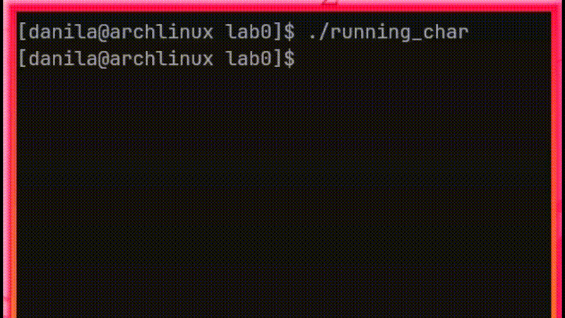

# lab0 — Running Character

   

A small terminal animation written in C++ with ncurses. A single character (`@` by default) runs back and forth along one line of the terminal, and you control it from the keyboard.



## Features

- Character moves along a line and stays inside the window bounds
- Keyboard controls for direction, speed, pause and quit
- Non-blocking input, so the animation never waits for a keypress
- Fixed-timestep main loop based on `std::chrono::steady_clock`
- Header-only modules with a clear separation of responsibilities

## Requirements

- A C++17 compiler (developed with `clang++`)
- ncurses (`ncurses` on Arch Linux, `libncurses-dev` on Debian/Ubuntu)
- A terminal emulator that supports ncurses

## Build

```bash
clang++ -O2 main.cpp -o running_char -lncurses
```

## Run

```bash
./running_char
```

## Controls

| Key | Action                        |
|-----|-------------------------------|
| `a` | Move left                     |
| `d` | Move right                    |
| `+` | Increase speed                |
| `-` | Decrease speed                |
| `p` | quit                          |

## Project structure

| File             | Responsibility                                                                 |
|------------------|--------------------------------------------------------------------------------|
| `main.cpp`       | Creates the objects and starts the engine                                      |
| `engine.hpp`     | `Engine`: main loop, timing (tick = `1024 ms / speed`)                         |
| `context.hpp`    | `SimulationContext`: position, direction, symbol, speed, running flag          |
| `simulation.hpp` | `Simulation`: advances the character one step, respecting the world bounds     |
| `controls.hpp`   | `Controler` and `KeyMap`: maps key presses to actions                          |
| `listener.hpp`   | `Listener`: ncurses setup and non-blocking `getch()` input                     |
| `render.hpp`     | `Renderer`: draws the current frame                                            |
| `utils.hpp`      | `current_window_size()`: queries the terminal size via `ioctl(TIOCGWINSZ)`     |

## How it works

1. `Listener` initializes ncurses and polls the keyboard without blocking.
2. `Controler` translates the pressed key into a change of the shared `SimulationContext` (direction, speed, pause).
3. Once per tick, `Simulation::step()` moves the character by one cell and keeps it within `[0, width - 1]`.
4. `Renderer` draws the line with the character at its current position.
5. `Engine` ties it all together in a loop; the tick length is derived from the current speed.

## License

Educational project. Use it however you like.
